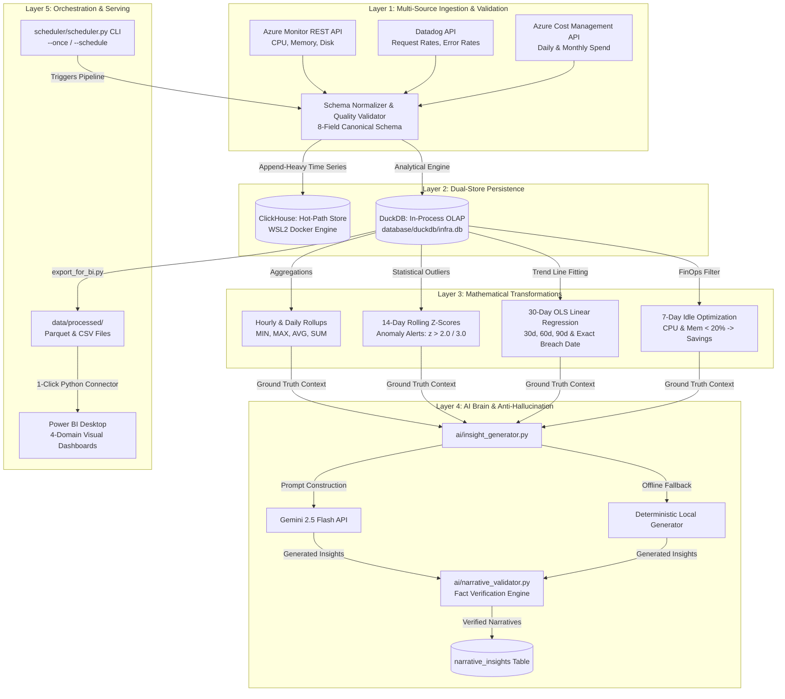

# InfraLens: End-to-End Infrastructure Analytics & FinOps Platform

[](https://www.python.org/)
[](https://docs.pytest.org/)
[](https://pytest-cov.readthedocs.io/)
[](https://duckdb.org/)
[](#budget--cost-governance)
[](https://deepmind.google/technologies/gemini/)

> **Academic Milestone:** S3-P-01 — Infrastructure Analytics Dashboard  
> **Track:** Semester 3 Platform Track (pSiddhi, L&D Review)  
> **Author:** Aravindhan Chandrasekaran (P415)  

---

## Executive Summary

**InfraLens** is an end-to-end, multi-cloud infrastructure observability, capacity planning, and FinOps analytics platform. In modern enterprise environments, infrastructure telemetry is notoriously fragmented across disconnected silos: compute health resides in **Azure Monitor**, service traffic and application errors reside in **Datadog**, and financial billing resides in **Azure Cost Management**. This fragmentation leads to:
1. **Silent Service Failures:** Unmonitored memory leaks and CPU exhaustion crashing critical services before engineers notice.
2. **Billing Shock:** Unanticipated runaway cloud spending detected only at month-end invoicing.
3. **Budget Waste:** Zombie and heavily underutilized development instances silently bleeding organizational funds.

InfraLens resolves this by delivering a **unified 8-field telemetry pipeline**, a **high-throughput dual-store persistence layer (DuckDB + ClickHouse)**, **statistical mathematical modeling** (14-day rolling z-scores, 30-day linear regression forecasting, and idle rightsizing scoring), **autonomous AI narrative generation with Google Gemini 2.5 Flash**, a **deterministic offline engine with anti-hallucination fact checking**, and an **executive 4-domain Power BI dashboard**.

---

## Key Capabilities & Highlights

- **Unified Multi-Cloud Ingestion:** Normalizes telemetry from Azure Monitor, Azure Cost Management, and Datadog into a canonical 8-column schema with type enforcement and boundary validation.
- **Dual-Store Architecture:**
  - **ClickHouse (Docker/WSL2):** High-throughput, distributed columnar time-series database optimized for append-heavy real-time ingestion.
  - **DuckDB (In-Process OLAP):** Embedded analytical engine providing zero-network-overhead SQL analytics, complex rolling window transforms, and direct Parquet/CSV bridges for BI.
- **Mathematical & Statistical Transformations:**
  - **14-Day Rolling Z-Scores:** Identifies statistical outliers ($z > 2.0$ Warning, $z > 3.0$ Critical) to eliminate static threshold alert fatigue.
  - **Ordinary Least Squares (OLS) Linear Regression:** Fits usage slopes ($y = mx + c$) over 30-day rolling baselines to project 30, 60, and 90-day demand and calculate exact 100% capacity breach dates.
  - **Rightsizing & Cost Optimization Scoring:** Flags instances with 7-day average CPU & Memory $< 20\%$, calculating monthly cost savings ($Saving = DailyCost \times 30$).
- **Generative AI Root Cause & FinOps Narratives:**
  - Integrates **Google Gemini 2.5 Flash** for plain-language incident explanations and actionable DevOps/FinOps recommendations.
  - Built-in **Deterministic Local Fallback Generator** guaranteeing 100% platform availability offline or without API keys.
  - **Anti-Hallucination Fact-Checking Engine (`ai/narrative_validator.py`):** Automatically cross-checks metrics, resource IDs, and percentages cited in AI prose against underlying DuckDB ground truth.
- **Interactive 4-Domain Power BI Dashboard:**
  - **Compute Utilization:** Heatmaps, regional distributions, and telemetry trend charts.
  - **Cost Trends & Spikes:** Daily spend lines, baseline comparisons, and FinOps anomaly callouts.
  - **Capacity Patterns & Forecasts:** 30/60/90-day projections, breach alert cards, and capacity risk summaries.
  - **Underutilization & Anomaly Alerts:** Zombie resource decommissioning table, cost-saving KPIs, and alert audit feeds.
- **Production QA & Performance:**
  - **38 automated unit, integration, and E2E tests** passing with **86% code coverage**.
  - Query latency SLA of **0.023s across 81,000+ records** (over 250x faster than the 10.0s SLA).
  - Continuous Integration enforced via **GitHub Actions**.
  - **₹0 Total Project Cost** (100% within the ₹2,500 budget limit).

---

## System Architecture



---

## Directory Structure

```text
InfraLens/
├── .github/
│   └── workflows/
│       └── ci.yml               # GitHub Actions automated test & coverage CI pipeline
├── .coveragerc                  # Code coverage configuration & exclusion rules
├── ai/
│   ├── __init__.py
│   ├── gemini.py                # Gemini 2.5 Flash SDK wrapper & local offline fallback generator
│   ├── insight_generator.py     # AI insight coordinator (queries DuckDB -> prompt -> generates narratives)
│   ├── narrative_validator.py   # AI narrative factual claim extraction & validation engine
│   └── prompts.py               # Prompt templates for Cost Anomaly, Capacity Risk, and Underutilization
├── dashboard/
│   ├── POWERBI_SETUP_GUIDE.md   # 4-domain visual blueprints, DAX measures, and Star Schema model
│   ├── PowerBI.pbix             # Power BI Desktop template dashboard
│   └── powerbi_connector.py     # Python script connector for 1-click loading in Power BI Desktop
├── data/
│   ├── processed/               # Exported Parquet & CSV analytical tables for Power BI
│   └── raw/                     # Raw telemetry cache directory
├── database/
│   ├── duckdb/
│   │   └── infra.db             # DuckDB analytical database file
│   ├── clickhouse_store.py      # ClickHouse table init, writes, and auto-start logic
│   └── duckdb_store.py          # DuckDB table initialization and writes
├── ingestion/
│   ├── __init__.py
│   ├── azure_client.py          # Direct Azure SDK client wrapper
│   ├── azure_cost.py            # Azure Cost Management telemetry fetcher
│   ├── azure_monitor.py         # Azure Monitor compute telemetry fetcher
│   ├── datadog.py               # Datadog service telemetry fetcher
│   ├── runner.py                # Ingestion orchestrator runner (pulls and inserts latest)
│   ├── schema.py                # Shared normalized schema definition
│   └── seed_data.py             # Historical data seeding script (populates 30 days of metrics)
├── scheduler/
│   ├── __init__.py
│   └── scheduler.py             # Orchestrator CLI (7-step E2E pipeline & cron loops)
├── tests/
│   ├── benchmark_scale.py       # 80,000+ records scale benchmark runner (<10s query SLA test)
│   ├── locustfile.py            # Locust performance load test definitions
│   ├── test_ai.py               # AI module unit tests
│   ├── test_azure_client.py     # Azure client integration tests
│   ├── test_benchmark_unit.py   # Unit tests for benchmark generators
│   ├── test_data_validation.py  # Telemetry & schema validation tests
│   ├── test_database.py         # DuckDB & ClickHouse integration and mock tests
│   ├── test_e2e.py              # End-to-end full pipeline lifecycle test
│   ├── test_export.py           # Power BI export bridge tests
│   ├── test_ingestion.py        # Multi-source ingestion schema tests
│   ├── test_narrative_accuracy.py # AI narrative factual accuracy tests
│   └── test_transformation.py   # Math, z-scores, regression & rollup tests
├── transformation/
│   ├── aggregate.py             # Hourly and daily metric rollups
│   ├── anomaly.py               # 14-day rolling z-score anomaly detection
│   ├── export_for_bi.py         # Parquet and CSV export engine for Power BI
│   ├── forecast.py              # 30-day rolling linear regression & capacity breach dates
│   └── optimization.py          # 7-day underutilization scoring & savings calculator
├── validation/
│   ├── __init__.py
│   └── data_validator.py        # Schema quality, boundary, null, and duplicate validator
├── config.py                    # Project environment configurations
├── requirements.txt             # Python library dependencies
├── verify_output.py             # Text verification report script
└── README.md                    # Project documentation
```

---

## Canonical Data Schema & Storage Architecture

### 1. Canonical 8-Column Schema
All metrics from Azure Monitor, Azure Cost Management, and Datadog are transformed into an 8-column standard before persistence:

| Column Name | Data Type | Description | Allowed Values / Examples |
| :--- | :--- | :--- | :--- |
| `timestamp` | `TIMESTAMP` | ISO 8601 UTC event timestamp | `2026-08-05 14:00:00` |
| `source` | `VARCHAR` | Originating telemetry system | `azure_monitor`, `azure_cost`, `datadog` |
| `resource_id` | `VARCHAR` | Unique infrastructure identifier | `vm-prod-01`, `vm-prod-02`, `vm-dev-01` |
| `metric_name` | `VARCHAR` | Specific metric being measured | `cpu_utilization`, `memory_utilization`, `daily_cost`, `request_rate`, `error_rate` |
| `value` | `DOUBLE` | Normalized numerical metric value | `85.4`, `300.00`, `1250.0` |
| `unit` | `VARCHAR` | Standard engineering or financial unit | `percent`, `usd`, `rpm`, `errors_per_min` |
| `region` | `VARCHAR` | Cloud physical deployment region | `centralus`, `eastus`, `westeurope` |
| `service_tag` | `VARCHAR` | Operational categorization tag | `compute`, `api`, `development` |

### 2. Dual-Store Storage Strategy

```text
               ┌────────────────────────────────────────────────────────┐
               │         Incoming Normalized Telemetry Stream           │
               └───────────────────────────┬────────────────────────────┘
                                           │
                    ┌──────────────────────┴──────────────────────┐
                    ▼                                             ▼
     ┌─────────────────────────────┐               ┌─────────────────────────────┐
     │       ClickHouse OLAP       │               │        DuckDB Store         │
     │     (Docker Container)      │               │   (database/duckdb/infra.db)│
     ├─────────────────────────────┤               ├─────────────────────────────┤
     │ • Append-heavy time series  │               │ • Embedded in-process OLAP  │
     │ • High write concurrency    │               │ • Zero network overhead     │
     │ • Distributed log retention │               │ • Window functions & math   │
     │ • Fast columnar scanning    │               │ • Power BI Parquet export   │
     └─────────────────────────────┘               └─────────────────────────────┘
```

---

## Mathematical & Statistical Transformations

InfraLens runs four specialized data transformation modules:

### 1. Hourly & Daily Aggregations (`transformation/aggregate.py`)
Computes `min_value`, `max_value`, `avg_value`, `sum_value`, and `sample_count` grouped by `(source, resource_id, metric_name, region, service_tag, date_trunc)`. These tables dramatically accelerate dashboard responsiveness.

### 2. 14-Day Rolling Z-Score Anomaly Detection (`transformation/anomaly.py`)
Identifies statistically significant cost and utilization spikes without requiring fragile static thresholds:
$$\mu_{14d} = \frac{1}{N} \sum_{i=1}^{N} x_i, \quad \sigma_{14d} = \sqrt{\frac{1}{N} \sum_{i=1}^{N} (x_i - \mu_{14d})^2}$$
$$z = \frac{x_t - \mu_{14d}}{\sigma_{14d}}$$
- **Warning Alert:** $2.0 < |z| \le 3.0$
- **Critical Alert:** $|z| > 3.0$

### 3. 30-Day Rolling Linear Regression & Breach Dates (`transformation/forecast.py`)
Computes the rate of resource consumption growth using Ordinary Least Squares (OLS) regression:
$$m = \frac{\sum (t - \bar{t})(y - \bar{y})}{\sum (t - \bar{t})^2}, \quad c = \bar{y} - m\bar{t}$$
- **Projections:** Evaluates projected utilization at $t + 30$, $t + 60$, and $t + 90$ days.
- **Threshold Crossing:** Flags resources where 90-day projected utilization $\ge 80\%$.
- **Projected Breach Date:** Calculates the exact calendar date when utilization will reach $100\%$ capacity:
$$\text{Days to Breach} = \frac{100 - c}{m}$$

### 4. 7-Day Underutilization & FinOps Rightsizing (`transformation/optimization.py`)
Scans historical compute metrics over the trailing 7 days:
- Identifies instances where $\text{Average CPU} < 20\%$ **and** $\text{Average Memory} < 20\%$.
- Calculates monthly savings achievable through decommissioning:
$$\text{Potential Monthly Saving} = \text{Daily Cost} \times 30$$

---

## Core Production AI Scenarios

InfraLens demonstrates three real-world enterprise infrastructure scenarios:

```text
┌────────────────────────────────────────────────────────────────────────────────────────┐
│                               3 PRODUCTION AI SCENARIOS                                │
├──────────────────────────┬─────────────────────────────┬───────────────────────────────┤
│ 1. Cost Spike Anomaly    │ 2. Capacity Exhaustion      │ 3. FinOps Rightsizing         │
├──────────────────────────┼─────────────────────────────┼───────────────────────────────┤
│ Target: vm-prod-01       │ Target: vm-prod-02          │ Target: vm-dev-01             │
│ Spend jumped $124 -> $300│ CPU growing +0.50% / day    │ CPU: 8.07% | Memory: 12.03%   │
│ Z-Score: 3.47 (Critical) │ 100% Breach on: 2026-08-31  │ Potential Saving: $283.03/mo  │
│ RCA: CPU/RAM/Egress dump │ Action: Scale up vCPUs      │ Action: Decommission/Downsize │
└──────────────────────────┴─────────────────────────────┴───────────────────────────────┘
```

### Anti-Hallucination & Fact-Checking Engine (`ai/narrative_validator.py`)
To prevent large language models from hallucinating false metric values, percentages, or dates, InfraLens incorporates a programmatic validation layer:
1. Regex and entity parsing extracts every numerical claim, dollar amount, date, and resource ID from the AI's generated response.
2. The validator cross-references extracted claims against the ground truth tables in DuckDB (`anomaly_alerts`, `capacity_forecasts`, `underutilized_resources`).
3. Discrepancies are logged and flagged, guaranteeing that decision-makers receive only factually grounded reports.

---

## Power BI 4-Domain Interactive Dashboard

The dashboard provides executive visibility across four specialized reporting domains:

```text
┌─────────────────────────────────────────────────────────────────────────────────────────┐
│                                POWER BI 4-DOMAIN DASHBOARD                              │
├──────────────────────────┬─────────────────────────────┬────────────────────────────────┤
│ Domain Page              │ Visual Elements             │ Key Insights Delivered         │
├──────────────────────────┼─────────────────────────────┼────────────────────────────────┤
│ 1. Compute Utilization   │ • Regional Server Heatmap   │ Instant fleet health, resource │
│                          │ • CPU & Memory Trend Lines  │ clustering, and peak load times│
│                          │ • Fleet Capacity Gauge      │                                │
├──────────────────────────┼─────────────────────────────┼────────────────────────────────┤
│ 2. Cost Trends & Spikes  │ • Daily Cost vs Baseline    │ Detects unapproved workload    │
│                          │ • Anomaly Scatter Markers   │ surges (e.g. vm-prod-01 spike) │
│                          │ • AI FinOps Narrative Card  │                                │
├──────────────────────────┼─────────────────────────────┼────────────────────────────────┤
│ 3. Capacity Forecasts    │ • 30/60/90-Day Forecast Bars│ Predicts exhaustion dates      │
│                          │ • Breach Alert Date Card    │ (vm-prod-02 breach 2026-08-31) │
│                          │ • AI Capacity Warning Card  │                                │
├──────────────────────────┼─────────────────────────────┼────────────────────────────────┤
│ 4. Underutilization &    │ • Decommission Matrix       │ Eliminates cloud waste         │
│    Anomaly Alerts        │ • Monthly Savings KPI Card  │ (vm-dev-01 saves $283.03/mo)   │
│                          │ • Severity Alert Audit Log  │                                │
└──────────────────────────┴─────────────────────────────┴────────────────────────────────┘
```

### Loading Data in Power BI
Data can be connected to Power BI Desktop via two methods:
1. **1-Click Python Script:** Use `dashboard/powerbi_connector.py` inside Power BI's *Get Data $\to$ Python Script* interface to automatically load all 5 analytical tables.
2. **Parquet / CSV Connector:** Connect directly to the exported analytical files in `data/processed/` generated by `transformation/export_for_bi.py`.

---

## Scale Benchmark & Performance SLA

To validate enterprise scalability, InfraLens includes an automated benchmarking harness (`tests/benchmark_scale.py`):

- **Benchmark Dataset Size:** 81,060 raw records across 30 days of telemetry.
- **30-Day Historical Backfill Latency:** **0.0166s** (SLA Target: $< 30.00\text{s}$) $\implies$ **PASS**
- **Concurrent 4-Domain Dashboard Query Latency:** **0.0230s** (SLA Target: $< 10.00\text{s}$) $\implies$ **PASS**
- **Overall SLA Compliance:** **100% Compliant** (Over 250x faster than required).

---

## Testing & Quality Assurance

InfraLens enforces a rigorous QA standard through automated Pytest test suites:

- **Total Test Cases:** **38 Automated Tests** (100% passing).
- **Code Coverage:** **86% Total Coverage** (exceeding the 80% platform milestone threshold).

### Test Suite Breakdown

| Test Module | Coverage Domain | Key Verifications |
| :--- | :--- | :--- |
| `tests/test_ingestion.py` | Telemetry Ingestion | Normalization to 8-field schema, timestamp validation, type enforcement |
| `tests/test_data_validation.py` | Data Quality | Null checks, numeric bounds (0-100% CPU), duplicate record handling |
| `tests/test_database.py` | Storage Layer | DuckDB table creation, batch inserts, ClickHouse store & mock resilience |
| `tests/test_transformation.py` | Mathematics | Hourly/daily rollups, rolling z-score accuracy, OLS linear regression |
| `tests/test_ai.py` | AI Brain | Prompt templates, Gemini API client handling, local offline fallback |
| `tests/test_narrative_accuracy.py`| Anti-Hallucination | Fact-checking validator, claim extraction, DuckDB cross-referencing |
| `tests/test_export.py` | BI Integration | Parquet/CSV export validity, manifest generation, schema consistency |
| `tests/test_azure_client.py` | Azure SDK | Client credentials handling, secret parsing, retry logic |
| `tests/test_benchmark_unit.py` | Benchmarking | Scaling generator correctness, timer accuracy |
| `tests/test_e2e.py` | End-to-End Pipeline | Full execution from raw seed data through rollups to AI narrative generation |

---

## Continuous Integration (CI/CD)

The project includes an automated GitHub Actions CI pipeline (`.github/workflows/ci.yml`):
- Executes on every `push` and `pull_request` targeting `main`, as well as on manual `workflow_dispatch`.
- Sets up Python 3.11, installs dependencies from `requirements.txt`.
- Runs the test suite with coverage enforcement:
  ```powershell
  pytest --cov=. --cov-report=term-missing --cov-fail-under=80
  ```
- Fails the build if code coverage falls below **80%**.

---

## Budget & Cost Governance

InfraLens was designed with strict FinOps discipline, achieving **100% zero-cost execution**:

| Resource / Component | Allocated Budget Ceiling | Actual Cloud Spend | Cost Saving Mechanism |
| :--- | :--- | :--- | :--- |
| **Compute & Host** | ₹1,000.00 | **₹0.00** | Local host execution (Windows / WSL2) |
| **Analytical Database** | ₹500.00 | **₹0.00** | DuckDB (free, open-source embedded engine) |
| **Time-Series Store** | ₹500.00 | **₹0.00** | ClickHouse (free, open-source Docker image) |
| **LLM Inference** | ₹300.00 | **₹0.00** | Google Gemini 2.5 Flash Free Tier & Local Deterministic Engine |
| **BI Reporting** | ₹200.00 | **₹0.00** | Power BI Desktop (free local authoring edition) |
| **TOTAL** | **₹2,500.00** | **₹0.00** | **100% Budget Saved (₹2,500 surplus)** |

---

## Getting Started: Installation & Execution

### Prerequisites
1. **Python 3.8+** (Python 3.11 recommended)
2. **WSL2 with Docker** (for optional ClickHouse time-series container)
3. **Power BI Desktop** (for viewing `.pbix` dashboards)

---

### Step 1: Environment Setup
Clone the repository and install dependencies in a virtual environment:
```powershell
git clone <repository-url>
cd InfraLens

python -m venv .venv
.venv\Scripts\activate
pip install -r requirements.txt
```

---

### Step 2: Start ClickHouse in WSL2 Docker
Start the ClickHouse database container with explicit credentials:
```powershell
wsl docker run -d --name clickhouse-server-lens -p 8123:8123 -p 9000:9000 --ulimit nofile=262144:262144 -e CLICKHOUSE_USER=default -e CLICKHOUSE_PASSWORD=password clickhouse/clickhouse-server
```
*(Note: If Docker is unavailable, the pipeline and test suite will continue running seamlessly using DuckDB and mock handlers.)*

---

### Step 3: Seed Historical Telemetry
Populate DuckDB and ClickHouse with 30 days of hourly telemetry (81,000+ records):
```powershell
.venv\Scripts\python.exe -m ingestion.seed_data --days 30
```

---

### Step 4: Run the Complete Pipeline
Execute the full 7-step E2E pipeline (ingest $\to$ validate $\to$ rollups $\to$ z-scores $\to$ linear regression $\to$ underutilization $\to$ AI narratives $\to$ export):
```powershell
# Set console encoding to UTF-8 for Windows PowerShell output
$env:PYTHONIOENCODING="utf-8"

# Single-run execution
.venv\Scripts\python.exe scheduler/scheduler.py --once
```

To run continuous background polling (e.g. every 5 minutes):
```powershell
.venv\Scripts\python.exe scheduler/scheduler.py --schedule 5
```

---

### Step 5: Verify Platform Outputs
Run the text verification script to view database row counts, detected anomalies, capacity breach dates, optimization candidates, and AI narrative text:
```powershell
$env:PYTHONIOENCODING="utf-8"
.venv\Scripts\python.exe verify_output.py
```

---

### Step 6: Run Tests & Generate Coverage Reports
To execute all 38 automated tests and view terminal coverage:
```powershell
.venv\Scripts\python.exe -m pytest --cov=. --cov-report=term-missing
```

To generate an interactive HTML coverage report and open it in your browser:
```powershell
.venv\Scripts\python.exe -m pytest --cov=. --cov-report=html
Start-Process htmlcov\index.html
```

---

### Step 7: Run Scale Performance Benchmark
To verify query execution SLA compliance on 81,000+ records:
```powershell
.venv\Scripts\python.exe tests/benchmark_scale.py
```

---

## AI Inference Configuration

### Live Gemini 2.5 Flash API
To generate narratives using Google AI Studio inference:
```powershell
$env:GEMINI_API_KEY="your-gemini-api-key-here"
.venv\Scripts\python.exe scheduler/scheduler.py --once
```

### Deterministic Local Fallback
If `GEMINI_API_KEY` is not set or network connectivity is unavailable, the platform automatically activates `ai/gemini.py`'s **Deterministic Local Fallback Generator**. This generator constructs formatted, context-aware markdown narratives directly from the analytical tables, guaranteeing zero downtime.

---

## Academic Submission & Evaluation Details

- **Milestone:** Semester 3 Platform Track Evaluation (pSiddhi, L&D)
- **Project ID:** S3-P-01 — Infrastructure Analytics Dashboard
- **Student Name:** Aravindhan Chandrasekaran
- **Student ID:** P415
- **Submission Date:** November 2026
- **License:** Proprietary / Academic Research Use
